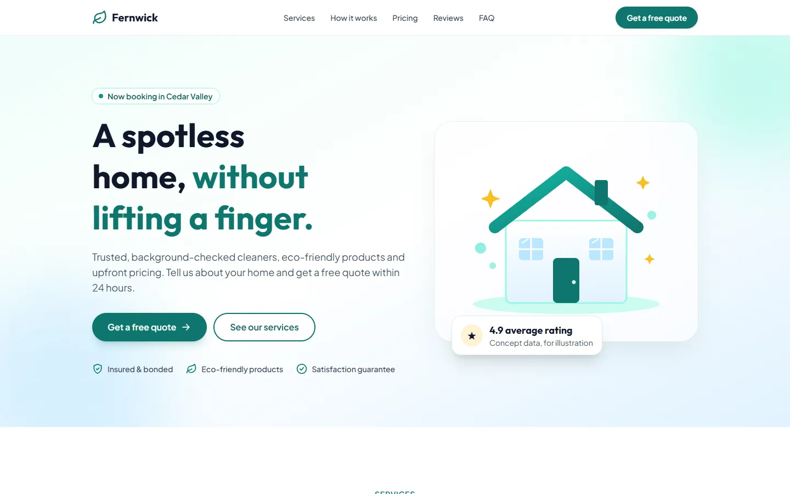
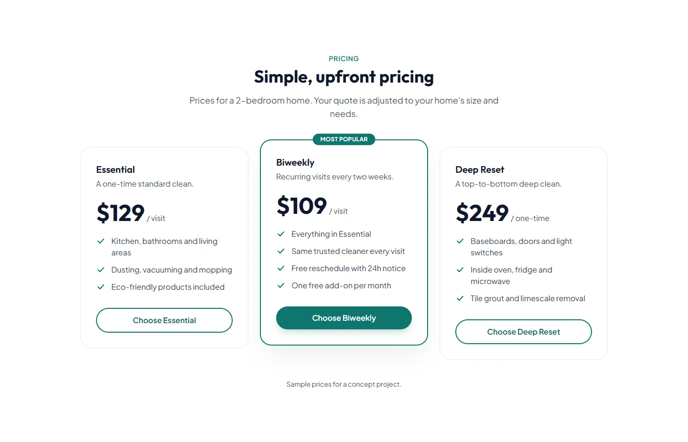
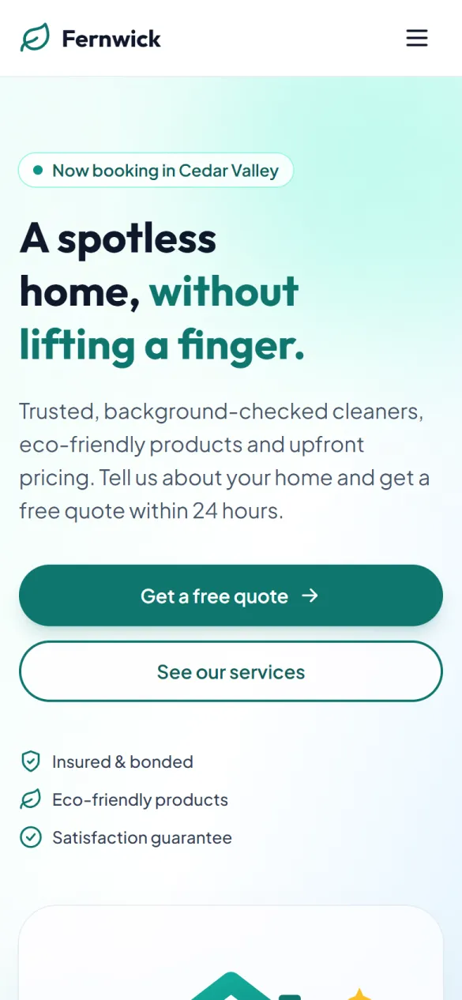

# Fernwick Home Cleaning



<p>
  
  
</p>

Fernwick Home Cleaning is a **fictional concept business**: a residential cleaning service. This repository contains its marketing landing page, built with HTML, Tailwind CSS and a little vanilla JavaScript.

**Live demo:** [fernwick.renzzogg.com](https://fernwick.renzzogg.com)

## The landing page

- Hero section with calls to action and trust indicators.
- Services, "Book in three simple steps", pricing, reviews and FAQ sections.
- Free quote form with client-side validation in JavaScript. It sends the request to the [Fernwick API](#the-quote-form-and-the-api) with `fetch`, and the quotes show up in the admin panel.
- Responsive layout with an accessible mobile menu (closes with Escape) and scroll reveal animations.
- Custom design tokens (brand colors and fonts) defined with Tailwind's `@theme`.

The business, its contact details and its reviews are all fictional.

## Tech stack

- HTML
- [Tailwind CSS](https://tailwindcss.com/) 4.3.3 (CLI, pinned to an exact version)
- JavaScript (no frameworks)
- Google Fonts (Outfit and Plus Jakarta Sans)

## How the build works

The source files live in the repository root. The build writes the publishable site to `dist/`, which is **not** committed:

```
index.html, js/, assets/  ──(scripts/copy-static.mjs)──▶  dist/
styles/input.css          ──(Tailwind CLI)─────────────▶  dist/css/styles.css
```

- `scripts/copy-static.mjs` copies `index.html`, `js/` and `assets/` into `dist/`.
- The Tailwind CLI reads `styles/input.css` (Tailwind v4 "CSS-first" config: `@theme` and `@source`, no `tailwind.config.js`), scans `index.html` and `js/` for class names and generates only the CSS that is actually used.

## Run it locally

Requires [Node.js](https://nodejs.org/) (LTS).

```bash
npm ci          # install the exact dependency versions from package-lock.json
npm run dev     # build into dist/ and rebuild on every save
npm run build   # clean dist/ and create a production build (minified CSS)
```

To view the site, serve `dist/` with any static server in another terminal, for example:

```bash
python3 -m http.server 8080 -d dist
```

Then open <http://localhost:8080>. (Port 8000 is left free for the API.)

## The quote form and the API

The form posts JSON to `POST /v1/public/quotes` of the Fernwick API (separate `fernwick-platform` repo). The API URL is chosen in `js/main.js` from the page's hostname:

| Page opened at | API used |
| --- | --- |
| `localhost` / `127.0.0.1` | `http://localhost:8000` |
| anything else | `https://fernwick-api.renzzogg.com` |

- The API only answers browsers whose origin is listed in its `CORS_ORIGINS`. For local development it must include `http://localhost:8080`.
- Field names follow the API: the form's `size` and `date` are sent as `home_size` and `preferred_date`.
- A hidden `website` field works as a honeypot against bots.
- Validation errors (422) are shown next to each field; too many requests (429), request too large (413), network errors and timeouts show a message with the phone and email as an alternative. The form keeps its data.

## Deployment

Deployed on [Railway](https://railway.com) at [fernwick.renzzogg.com](https://fernwick.renzzogg.com). Railway's builder ([Railpack](https://railpack.com)) detects `package.json`, runs `npm ci` and `npm run build`, and serves `dist/` as a static site with Caddy. This is configured with two service variables:

| Variable | Value |
| --- | --- |
| `RAILPACK_SPA_OUTPUT_DIR` | `dist` |
| `RAILPACK_NODE_NPM_INSTALL` | `npm ci` |

## Part of my portfolio

This project is part of the portfolio of **Renzzo Gracia Gomez** — see more at [renzzogg.com](https://renzzogg.com).
